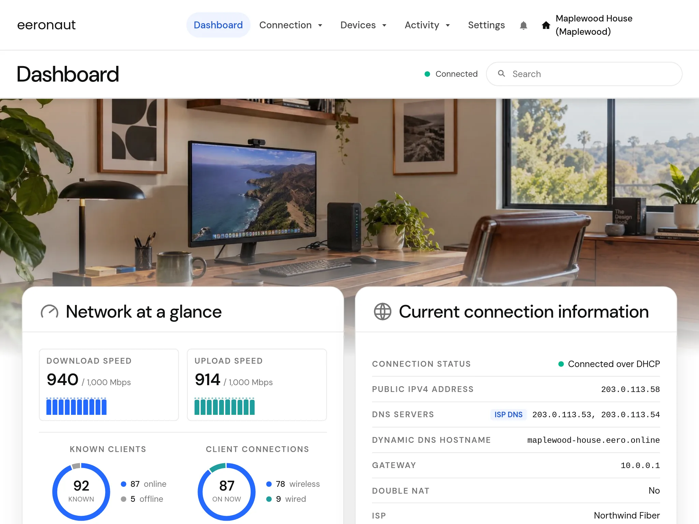

# Eeronaut

Manage your eero mesh network from Home Assistant's sidebar, or from any browser on your network.

Eeronaut is a web dashboard for eero: clients and profiles, a map of your mesh, Wi-Fi airtime, port forwarding and reservations, security and insights, and firmware updates. It talks to eero's cloud with your eero account, and to your eeros directly on your home network for live status.

Eeronaut has a full theming engine with several themes included.

Eeronaut is not affiliated with, endorsed by, or supported by eero LLC.

Learn more about Eeronaut [on GitHub](https://github.com/Bretteroo/Eeronaut)

